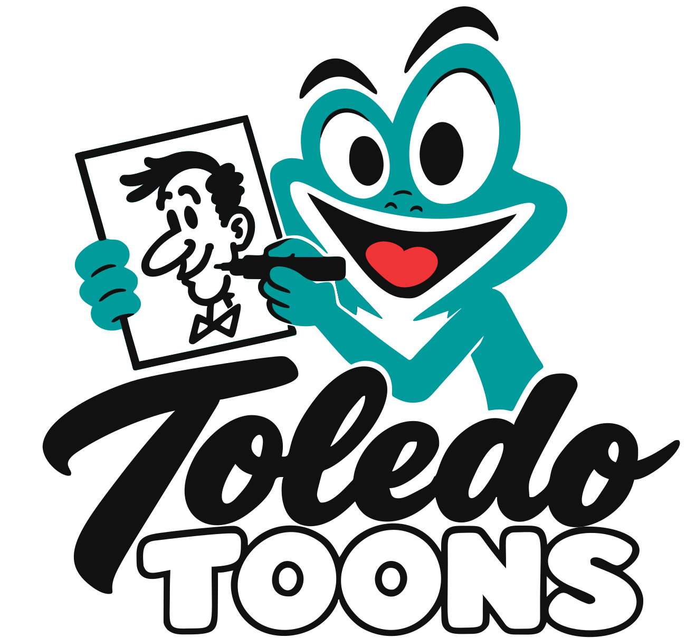

# Toledo Toons Responsive Banner Assets

Editable vector reconstruction of the supplied banner. All illustration files use flat fills, a purple sky, gray architecture, cream lights, and a straight billboard. Billboard faces are blank; your supplied logo is converted separately under `logo/`.

## Files

- `components/`: individual sky, moon, star, star field, two skyline layers, bridge, two tree layers, river, lamp, and three billboard formats.
- Each billboard also has separate face, posts, and lights SVGs. These share a viewBox and stack directly without repositioning.
- `scenes/banner-desktop.svg`: assembled 2048 x 682 banner, with blank wide billboard and open left side for website copy.
- `scenes/banner-mobile.svg`: assembled 720 x 960 composition, with open upper area for copy and a compact billboard below.
- `scenes/background-desktop.svg`: scenery without a billboard.
- `logo/Toledo_Toons_Logo.svg`: vector conversion of the supplied AI file, separate from the blank billboards.
- `layout.json`: exact billboard face and safe-area coordinates.
- `responsive-billboard.css`: optional placement rules for a website's existing logo and slideshow elements.

## Billboard Formats

| Format | SVG size | White face | Content |
| --- | --- | --- | --- |
| Wide | 1000 x 660 | 960 x 390 | Logo left, slideshow right |
| Compact | 640 x 620 | 600 x 400 | One centered logo |
| Small | 440 x 530 | 400 x 320 | One centered logo |

Use the wide format above 767 CSS pixels and compact below 768. The small format is an alternate for especially narrow placements. These are different proportions, so switch assets instead of squeezing the wide board.

SVGs do not decide whether a separate website slideshow is displayed. The included CSS hides `.billboard-slideshow` on mobile and enlarges `.billboard-logo` to occupy the whole safe area. Use `object-fit: contain` for the logo. Stop slideshow timers when hidden if your existing slideshow uses JavaScript.

## Optional Website Structure

```html
<div class="billboard">
  <picture class="billboard-art">
    <source media="(max-width: 767px)" srcset="components/billboard-compact.svg">
    
  </picture>
  
  <div class="billboard-slideshow"><!-- Your existing slideshow --></div>
</div>
```

## Illustrator

Open any SVG directly in Illustrator. Shapes are editable; composed scenes have named groups. Component files are self-contained with no linked images, fonts, filters, or scripts. Scenery layers use the same 2048 x 682 artboard for easy stacking. Isolated objects use tight local viewBoxes. Keep white fills opaque when using a transparent background.

The skyline is an illustrated reconstruction of the reference, including simplified landmark-like towers and a cable-stayed bridge, not an architectural survey. This package does not modify your live website.
